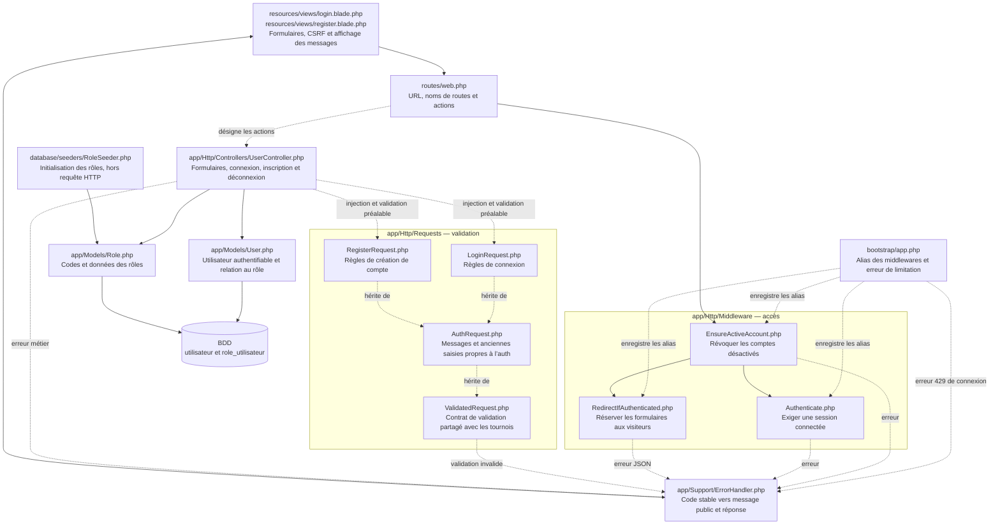
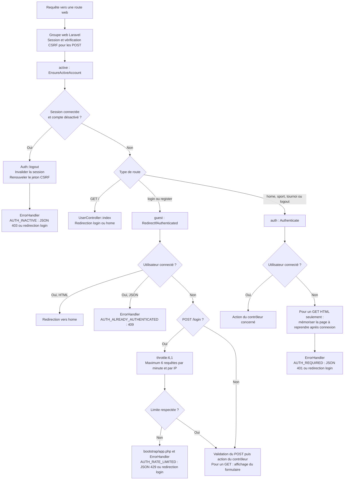
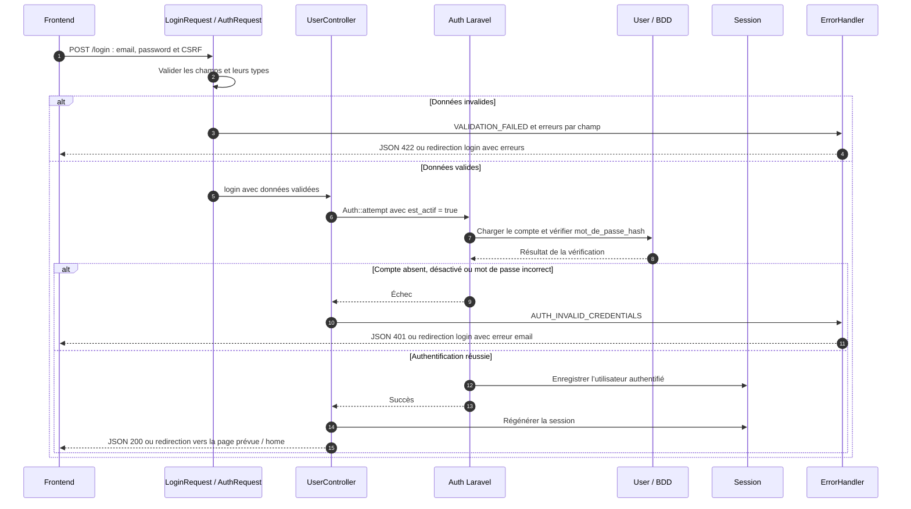
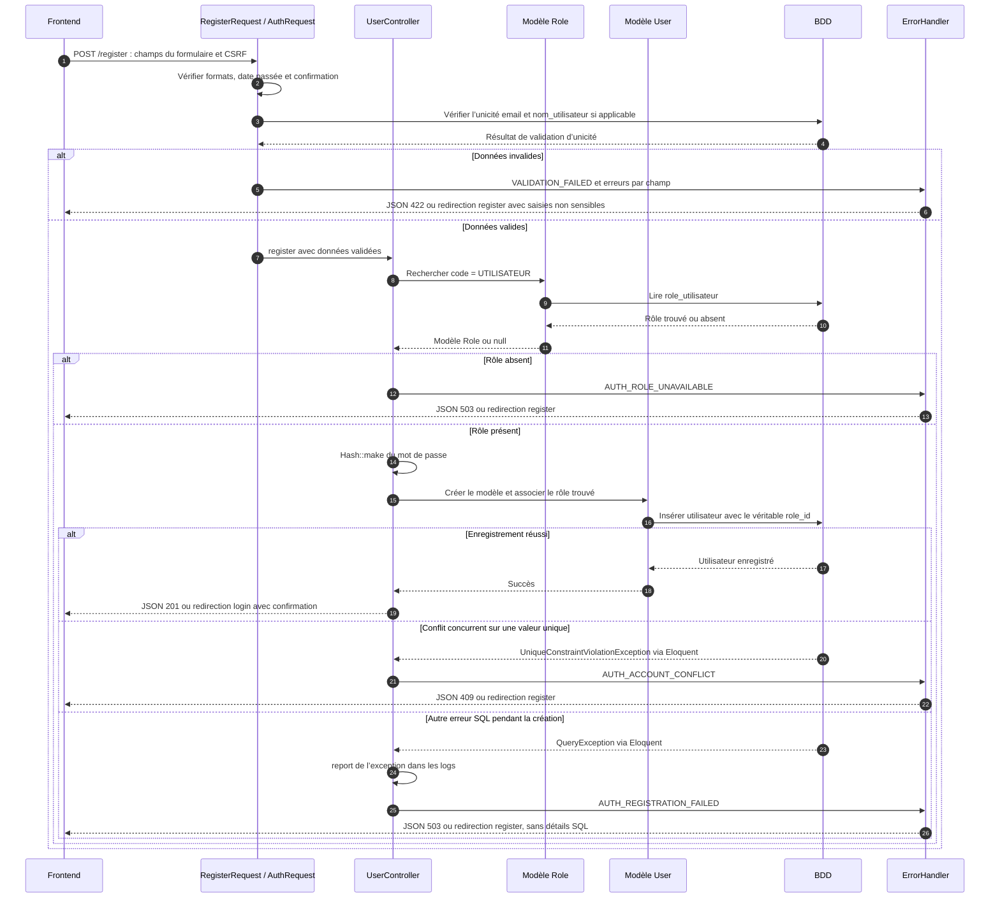
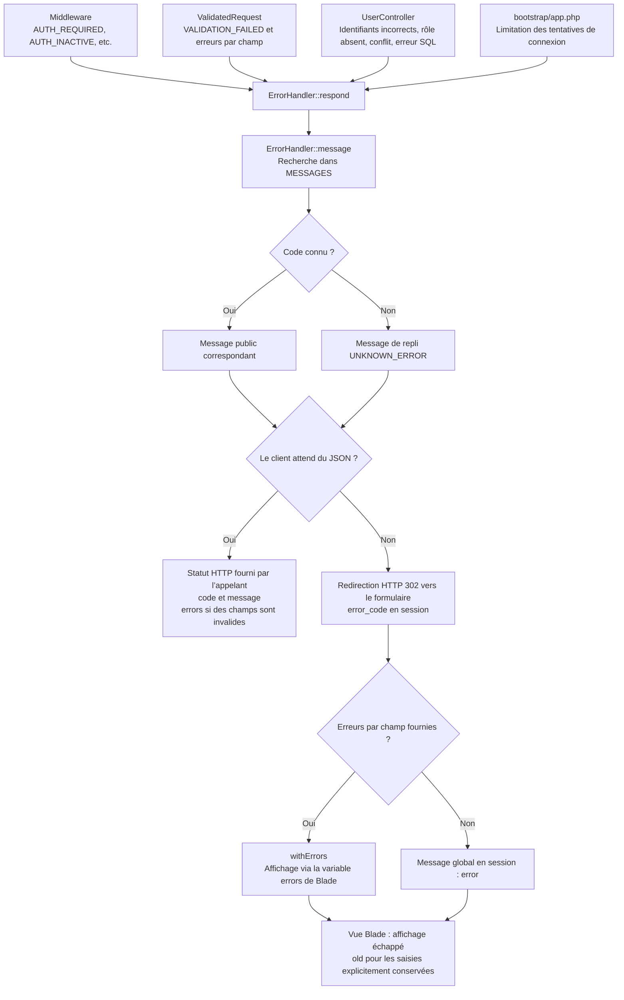
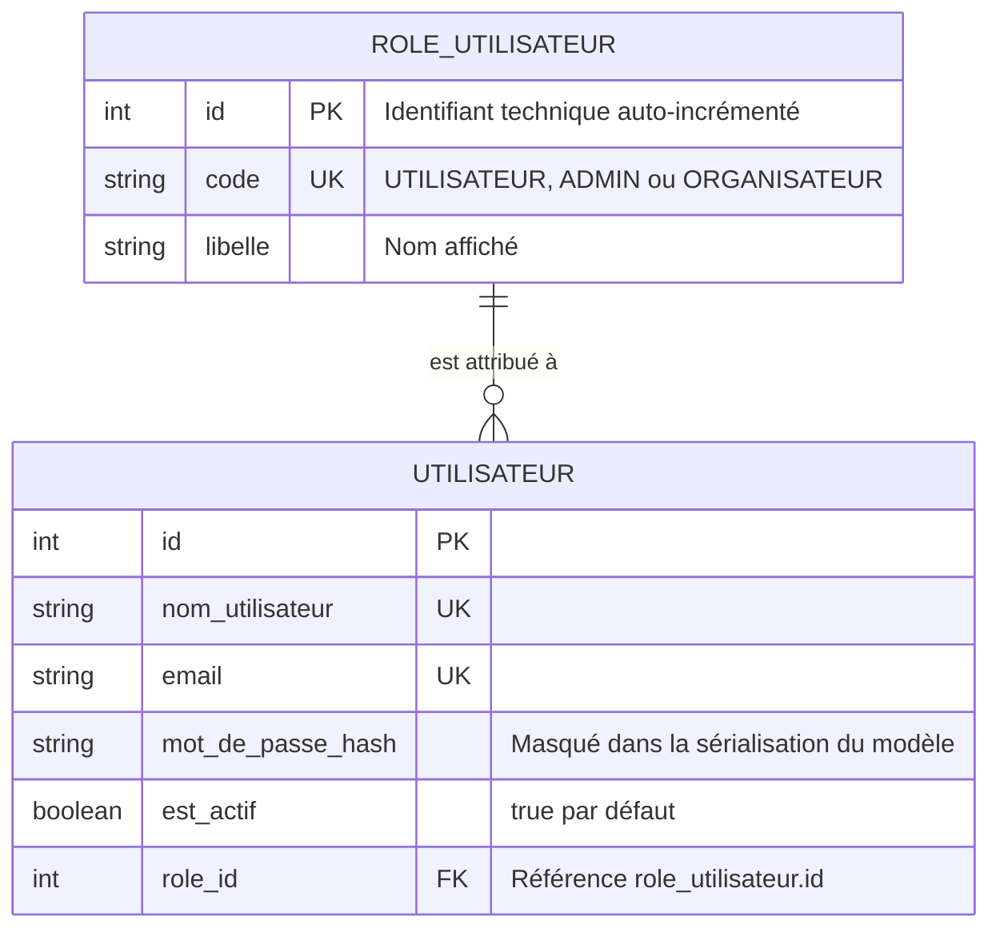
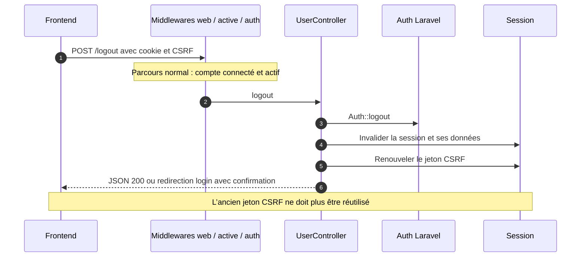

# Authentification — schémas Mermaid

Ces schémas décrivent le code actuel, pas une architecture future. Ils sont
consultables directement sur GitHub ou dans un lecteur Markdown compatible Mermaid.
L’authentification repose sur le cookie et la session Laravel, même en JSON.

## 1. Carte des fichiers et responsabilités

Les flèches indiquent les liens entre composants. L’ordre réel d’une requête est
détaillé dans les schémas suivants : une `FormRequest` valide les données **avant**
l’exécution de l’action du contrôleur.

**À retenir :** les routes ne font pas de SQL ; les middlewares contrôlent l’accès ;
les Requests valident ; le contrôleur orchestre ; les modèles accèdent aux données.
`ErrorHandler` ne consulte pas la BDD.

## 2. Contrôles d’accès : active, guest et auth

`active` et `auth` n’ont pas la même fonction : le premier vérifie un compte déjà
connecté ; le second exige qu’une connexion existe. Un compte désactivé tentant de
se connecter est refusé dans `Auth::attempt()`, avec le message générique des
identifiants incorrects. Les échecs CSRF restent gérés par Laravel, hors catalogue.

## 3. Connexion : du formulaire à la session

Le parcours ci-dessous suppose que les middlewares ont autorisé la requête.

`User` indique à Laravel le nom du champ de hachage : `mot_de_passe_hash`.
Le mot de passe n’est jamais comparé en clair dans une requête SQL. La régénération
protège contre la fixation de session ; l’ancienne page POST n’est jamais rejouée.

## 4. Inscription : validation, rôle et sauvegarde

Ce parcours distingue la validation préalable et l’insertion protégée par les
contraintes SQL. Le frontend ne choisit ni le rôle ni l’état actif du compte.

La création de compte ne connecte pas automatiquement l’utilisateur. Les erreurs
SQL interceptées dans ce schéma sont celles du bloc de création du contrôleur ;
`ErrorHandler` n’est pas un gestionnaire global de toutes les exceptions Laravel.

## 5. ErrorHandler : du code au message frontend

Le code est stable et sert aux décisions du frontend ; le message est destiné à
l’utilisateur. Les modèles `FIELD_REQUIRED`, `FIELD_MIN`, etc. servent aux messages
de validation ; le code global reste `VALIDATION_FAILED`.
Le statut d’une erreur JSON ne devient pas le statut de sa redirection HTML.

## 6. Modèles User et Role : ce que la BDD garantit

Seuls les champs utiles à cette explication sont représentés.

- `app/Models/User.php` correspond à `utilisateur` et déclare `role()` (`belongsTo`).
- `app/Models/Role.php` correspond à `role_utilisateur` et déclare `users()` (`hasMany`).
- L’application recherche le rôle par `code = UTILISATEUR`, puis utilise son ID réel.
  L’ID `1` n’est pas imposé ; les IDs existants ne sont pas renumérotés.
- `RoleSeeder` ajoute les rôles absents ou actualise leurs libellés/descriptions par
  code. **Cela peut modifier les données des rôles**, pas la structure des tables,
  les comptes utilisateurs ou leurs références de rôle existantes.
- Le seeder est une commande d’installation/maintenance : il n’est pas exécuté
  automatiquement à chaque inscription. Si le rôle manque, l’inscription est refusée.

## 7. Déconnexion : fin de la session

Si le compte est désactivé, `active` révoque la session avant d’atteindre cette
action et renvoie `AUTH_INACTIVE`. Un visiteur est refusé par `auth`.

## Documents complémentaires

- [Architecture et diagnostic des rôles](authentication.md)
- [Champs, routes et réponses attendus par le frontend](auth-frontend.md)
- [Catalogue complet des erreurs](errors.md)
