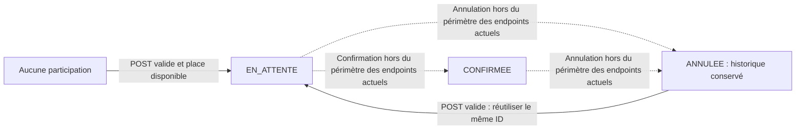

# Profil, consultation et inscriptions aux tournois

Cette intégration reprend le profil et l’affichage des inscriptions de `developDB`
(PR #9), sans remplacer les parcours d’authentification et de création de tournois
existants. Aucune migration ni modification des données locales n’est nécessaire.

## Routes et navigation

Toutes ces routes sont dans le groupe `web`, puis `active` et `auth`.

| Méthode | URL | Nom de route | Fonction |
| --- | --- | --- | --- |
| GET | `/profil` | `profil` | Informations du compte de la session et historique de ses participations. |
| GET | `/sport` | `sport` | Tous les tournois, toutes disciplines confondues. |
| GET | `/sport/{name}` | `sport` | Catégorie identifiée par son slug et tous ses descendants. |
| GET | `/tournoi/{id}/inscription` | `tournament.registration` | Situation du joueur et confirmation possible. |
| POST | `/tournoi/{id}/inscription` | `tournament.registration.store` | Inscription ou réactivation d’une participation annulée. |
| POST | `/logout` | `logout` | Déconnexion, accessible par le bouton du profil. |

`/tournament` reste le formulaire de **création** réservé aux organisateurs.
Les méthodes `create`, `store`, `index`, `showRegistration` et `register` sont
conservées dans `TournamentController`.

Le lien profil est partagé dans `partials/profile-link.blade.php`. Le retour aux
tournois, le formulaire de confirmation, le profil et la déconnexion utilisent des
routes nommées, pas des URL reconstituées à la main.

## Responsabilités et modèles

| Élément | Responsabilité |
| --- | --- |
| `ProfilController` | Charger uniquement le compte de la session, son âge et ses inscriptions. |
| `TournamentController::index` | Résoudre le slug, charger les tournois et les inscriptions du seul spectateur connecté. |
| `TournamentController::showRegistration` | Charger la situation réelle, les places et la clôture ; aucun flash de succès ne décide si le joueur est inscrit. |
| `TournamentController::register` | Vérifier les règles et créer ou réactiver la participation dans une transaction. |
| `Category::subtreeIds()` | Inclure une catégorie, ses tournois directs et tous ses descendants. |
| `TournamentRegistration` | Représenter le pivot `inscription` et distinguer les participations actives des annulations. |
| `RegistrationStatus` | Définir les codes métier et lire leurs IDs réels dans `statut_inscription`. |
| Vues et partial de statut | Afficher les données déjà chargées, avec des messages échappés et un badge cohérent. |

Les relations de création `Tournament::organizer()` et `category()`, les casts,
ainsi que `Category::parent()`, `children()` et `disciplines()` sont conservés.
Les relations francophones apportées par la PR restent disponibles :
`User::tournois()`, `Tournament::utilisateurs()`, `Tournament::categorie()` et
`Category::tournois()`. Elles contiennent l’historique complet ; utiliser le modèle
`TournamentRegistration` et sa portée `active()` pour calculer les places.

Le profil n’accepte aucun ID utilisateur dans sa route. Un paramètre de requête
`user_id` ne change pas le compte affiché. Les mots de passe et hachages ne sont
jamais présentés. Les champs personnels sont échappés par Blade.

## Slugs et catégories

Le nom de route est un slug : `/sport/tennis-de-table` doit résoudre la catégorie
« Tennis de table », pas exécuter un filtre `nom = 'tennis-de-table'`.
La comparaison utilise `Str::slug()` des deux côtés, indépendamment de la casse et
des accents de la BDD. Un slug inconnu renvoie 404 ; il ne retourne pas tous les tournois.

Une catégorie parente regroupe ses propres tournois et ceux de tous ses descendants,
y compris les niveaux imbriqués. Les parcours de l’arbre évitent les boucles si des
catégories cycliques ont été introduites dans les données.

**Limite héritée :** le schéma ne garantit pas l’unicité des noms ou des slugs.
Éviter deux catégories dont le slug est identique ; une gestion de slugs uniques
ou d’URLs contenant un ID nécessiterait un chantier distinct.

## Statuts d’inscription : ne pas confondre enregistré et confirmé

| Code en BDD | Badge | Réserve une place ? | Nouvelle inscription sur cette même ligne ? |
| --- | --- | --- | --- |
| `EN_ATTENTE` | En attente | Oui | Non : participation déjà active. |
| `CONFIRMEE` | Confirmée | Oui | Non : participation déjà active. |
| `ANNULEE` | Annulée | Non | Oui, si les inscriptions sont ouvertes et une place reste disponible. |

Le profil garde les annulations dans l’historique mais les exclut du nombre
d’inscriptions actives. La liste de catégorie exclut les annulations de son
récapitulatif actif et propose « Se réinscrire au tournoi » quand c’est possible.
Un état inconnu n’est pas automatiquement transformé en nouvelle inscription.



Il n’y a **pas de nouvel endpoint d’annulation ou d’approbation** dans ce changement.
Les transitions vers `ANNULEE` ou `CONFIRMEE` peuvent provenir de données existantes
ou de futurs traitements métier. Cette intégration lit correctement ces états et
permet seulement la réinscription depuis un état annulé.

## Enregistrement et limites

1. Charger et verrouiller le tournoi dans une transaction.
2. Refuser une participation déjà active, puis vérifier la clôture et la capacité.
3. Compter les lignes `EN_ATTENTE` et `CONFIRMEE`, pas les annulations.
4. Rechercher `EN_ATTENTE` par code, sans imposer `statut_id = 1`.
5. Créer la participation depuis le compte de session ou réutiliser son pivot annulé.
6. Enregistrer la date et le statut, sans accepter de participant ou de statut injecté dans le POST.

La contrainte unique `(utilisateur_id, tournoi_id)` est conservée. Réutiliser une
ligne annulée évite un doublon SQL. La réinscription remplace son état et sa date :
il n’y a pas de journal séparé de toutes les transitions passées.
Une erreur technique annule la transaction,
y compris lors d’une réactivation, et ne renvoie pas les détails SQL au client.

Sur MySQL, `lockForUpdate()` sur le tournoi sérialise les inscriptions passant par
ce traitement, pour protéger les dernières places. SQLite ne simule pas ce verrou
de ligne : les tests en mémoire vérifient les scénarios séquentiels et le rollback,
pas une preuve de charge ou de concurrence MySQL.

Pour les anciennes lignes nullables : une capacité `null` signifie non limitée ;
une clôture `null` utilise le début du tournoi comme limite. La fin absente est
affichée « Non définie », pas remplacée par la date du jour. Le formulaire de
création continue d’exiger ces valeurs pour les nouveaux tournois.

## Réponses et erreurs

- Succès HTML : redirection vers le détail avec « Inscription enregistrée, en attente de confirmation. ».
- Succès JSON : HTTP 200, `message` et `redirect_url`.
- Conflit métier : HTTP 409 en JSON ; en HTML, redirection vers le détail avec `error_code` et `error` en session.
- Référentiel absent ou état inconnu : `TOURNAMENT_REGISTRATION_UNAVAILABLE`, HTTP 503 en JSON.
- Erreur SQL : `TOURNAMENT_REGISTRATION_FAILED`, HTTP 503 en JSON.

Voir [le catalogue complet](errors.md). Un tournoi inconnu ou un ID non numérique
renvoie 404. Un visiteur ou un compte désactivé reste contrôlé par les middlewares
existants. Les listes et le détail masquent le formulaire si la participation est
active, la date dépassée ou le tournoi complet ; le POST vérifie à nouveau les règles.

Les badges décrivent les **participations**. Le cycle métier du statut du tournoi
`A_VENIR` / `EN_COURS` / `TERMINE` reste distinct : il n’y a pas de nouveau workflow
automatique des tournois dans cette intégration.

## Nettoyage de l’ancien prototype

Le lancement documenté est `php artisan serve`, via `public/index.php`.
Les fichiers suivants n’étaient référencés que par l’ancien prototype PHP autonome
et ont été retirés ensemble :

- `index.php` à la racine ;
- `Controller/HomeController.php` ;
- `Models/SportModel.php` ;
- `Vue/home.php` et `Vue/sport.php` ;
- `css/style.css` à la racine.

Ne pas les confondre avec `app/Http/Controllers`, `app/Models`,
`resources/views` ou **`public/css/style.css`**, qui restent utilisés par Laravel.
Aucune dépendance, donnée utilisateur ni configuration privée n’est supprimée.

## Vérification

```bash
php artisan test
php artisan test --filter=ProfileRegistrationIntegrationTest
php artisan route:list --except-vendor
```

La suite existante de création de tournois et d’authentification est conservée.
Les tests supplémentaires couvrent profil privé et déconnexion, slugs complexes,
catégories imbriquées, statuts et capacité, annulation/réactivation, IDs de statut
variables, anciennes données nullables, erreurs et rollback. La vérification ne
revendique pas une couverture exhaustive ni une validation du PO.
